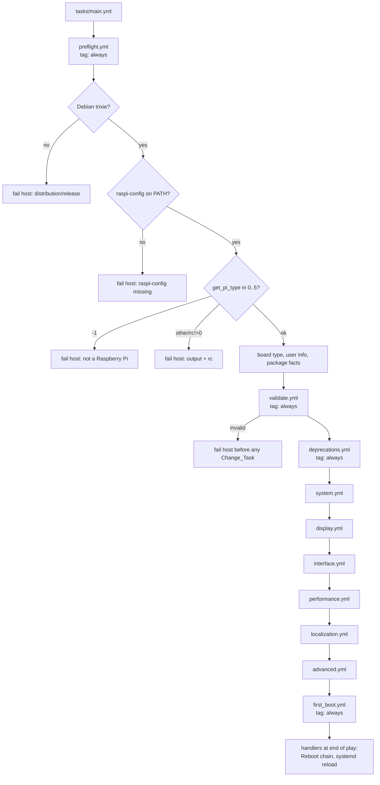
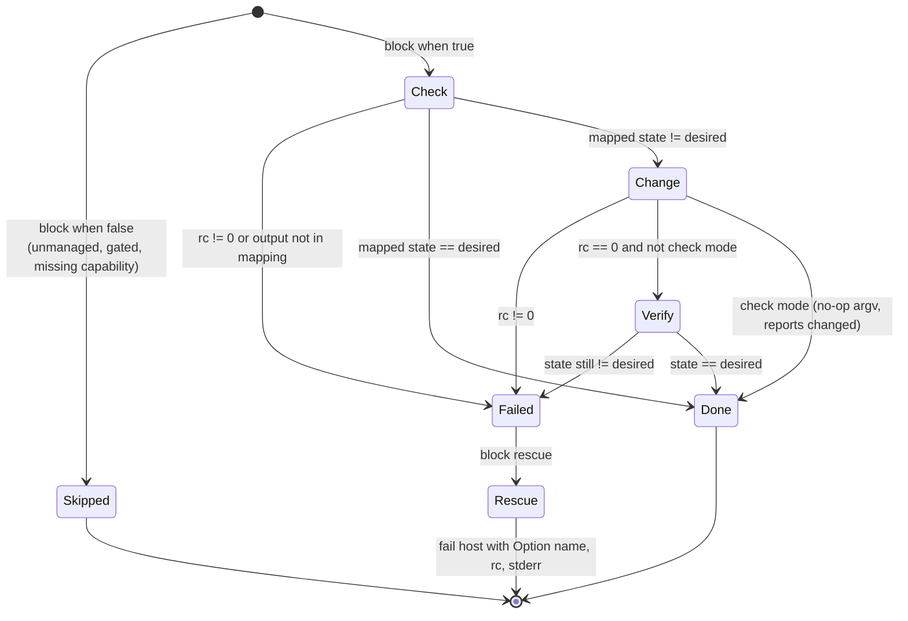
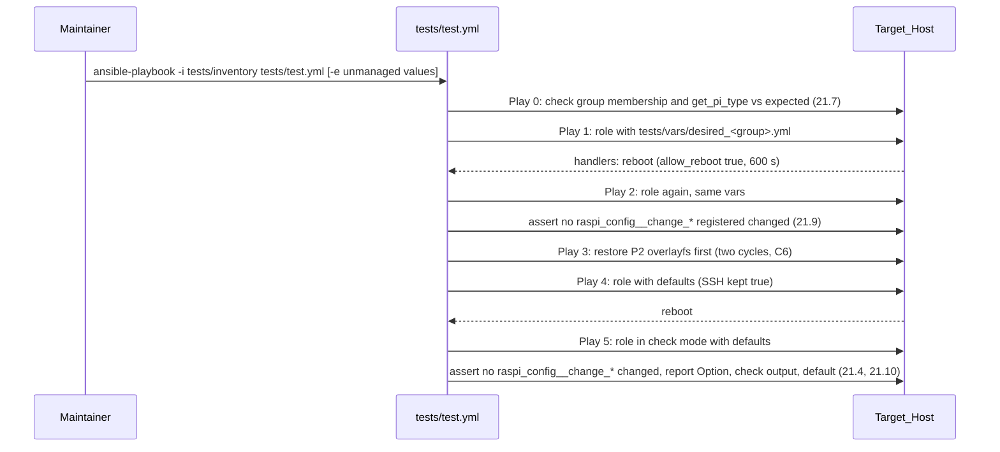

# Design Document: raspi-config-role-completion

## Overview

This design completes the `tkeemon.raspi_config` role against the `trixie` branch of the upstream `raspi-config` script (the Upstream_Script). It covers the foundations shared by every Option (preflight checks, validation, deprecation warnings, model gates, the check-then-change pattern, reboot handling, tags), the design of each Option in the six Submenu_Files, the `defaults/main.yml` layout, the hardware Test_Playbook, and CI.

The design is grounded in a line-by-line reading of the Upstream_Script at `https://raw.githubusercontent.com/RPi-Distro/raspi-config/trixie/raspi-config` (4,288 lines at the time of writing). Every `get_*` and `do_*` call, every 0/1 meaning, and every `ASK_TO_REBOOT` decision below comes from that file. Where the Upstream_Script disagrees with an acceptance criterion, the design follows the Upstream_Script and lists the disagreement in [Requirement conflicts and clarifications](#requirement-conflicts-and-clarifications). Those items need a maintainer decision before implementation of the affected Option starts.

### Key research findings

| Topic | Finding in the Upstream_Script | Effect on the design |
|---|---|---|
| Pi Zero 2 W model number (open item) | `get_pi_type` tests `is_pione`, `is_pitwo`, `is_pithree`, `is_pifour`, `is_pifive`, then `is_pizero`, in that order. `is_pithree` matches on the processor nibble (BCM2837), and the script comments that this "will also find CM3, CM4, Zero 2, 500, etc.". The Zero 2 W revision code `902120` matches `is_pithree`. | **Resolved:** the Zero 2 W reports `3`. The original Zero and Zero W (BCM2835) report `0`. The Zero host group keeps its expected Pi_Model as a group variable (Requirement 21.5) and the README documents both values. |
| Non-interactive entry point | `nonint` and `batch` both set `INTERACTIVE=False` and run before the root check. `batch f1 f2 ...` prints `f1 <output>` lines, one per function. | Check_Tasks that need several values (fan, overlay) use one `raspi-config nonint batch ...` call, so each Option keeps a single Check_Task (Requirement 2.1). |
| Per-user functions | `USER` is computed once at start-up as `${SUDO_USER:-...}`. `get_rpi_connect`, `do_rpi_connect`, `do_squeek*` also use `SUDO_UID` to build `XDG_RUNTIME_DIR`. | Every task that calls a per-user function sets `SUDO_USER` and `SUDO_UID` of `raspi_config_user` through the task `environment` keyword. Without this, the Upstream_Script would act on the Ansible remote user. |
| Inverted conventions | `get_wifi_power_save` prints `1` when power saving is **enabled**. `get_link_local_fallback` prints `1` when fallback is **enabled**. `get_usb_current` prints `1` when the default limit **applies**. `get_sudo_pass` prints `1` when **no** password is required. `get_boot_splash`, `get_blanking`, and most others print `0` for enabled. | Every boolean Option carries an explicit `true_output` in the option table in `vars/main.yml`. No task assumes "0 means enabled". |
| `ASK_TO_REBOOT` | Set in the menu-level function (any branch) of: S4, S5, S6, D2, D3 (interactive branch), D4, D5, I6 (`do_serial`/`do_serial_pi5`), I7, P1, P2, P3, A1, A2, A3, A6, A7, A8, A13. Not set for S1, S2, S7, S8, S9, S10, D1, D6, D7, I1 to I5, P4, L1 to L4, A11, A12. | This list is the reboot rule of Requirement 7.1 and 7.8 (see [Reboot handling](#reboot-handling)). |
| Silent no-ops | Several `do_*` functions exit 0 without reaching the requested state: `do_overlayfs` when RAM is 256 MB or less, `do_autologin` when `USER` is empty, `do_browser`, `do_journald_storage`, `do_rpi_connect`, `do_squeek*`, `do_audio`, `do_overscan_kms`. | Each Option re-reads its state after a change (Verify_Task) and fails with a message when the state was not reached. This catches silent no-ops in the first run instead of as an unexpected `changed` in the second run. |
| Time zone on trixie | Debian trixie `tzdata` no longer creates `/etc/timezone`, and a later release will remove it ([Proxmox installer change citing Debian](https://lore.proxmox.com/all/175812528559.2807291.12268456509796192912.b4-ty@proxmox.com/), [linuxcapable Debian 13 guide](https://linuxcapable.com/how-to-set-timezone-on-debian-linux/)). `do_change_timezone` still writes `/etc/timezone`. | The L2 Check_Task reads the `/etc/localtime` symlink target and falls back to `/etc/timezone` only when `/etc/localtime` is not a symlink. Listed as clarification C9. |
| Target Python | Trixie ships Python 3.13. ansible-core 2.18 is the first release whose target support includes Python 3.13 and it requires Python 3.8+ on targets ([ansible-core 2.18 porting guide](https://docs.ansible.com/projects/ansible-core/2.22/porting_guides/porting_guide_core_2.18.html)). | `min_ansible_version: "2.18"`. |
| Password hashes | Trixie stores yescrypt (`$y$`) hashes. `passlib` cannot produce or verify yescrypt, and Python 3.13 removed the `crypt` module. `perl-base` (Essential) exposes libxcrypt through `crypt()`. | The password Check_Task verifies the password on the Target_Host with `perl`. The Change_Task uses `ansible.builtin.user` with a SHA-512 hash and a stable per-host salt (clarification C11). |

Content from the cited web pages was rephrased for compliance with licensing restrictions.

### Scope

In scope: every trixie menu Option listed in the requirements inventory except A4, A5, A9, A10, A14, "8 Update", and "9 About". Removed Options (Legacy Camera, Remote GPIO, Pixel Doubling, GPU Memory, Network at Boot, xcompmgr, Glamor) get deprecation warnings only.

## Architecture

### File layout

```text
defaults/main.yml          Role_Variables (fresh-install defaults), grouped by submenu
vars/main.yml              Internal data: option table, model gates, value maps,
                           deprecated/renamed variable lists, validation expressions
handlers/main.yml          Reboot handler chain, systemd reload handler
meta/main.yml              Debian trixie, min_ansible_version 2.18
tasks/main.yml             Orchestration only (import_tasks)
tasks/preflight.yml        Release, raspi-config presence, Pi_Model, board type, user, package facts
tasks/validate.yml         Validation_Tasks (static and host-file checks)
tasks/deprecations.yml     Deprecated_Variable warnings
tasks/system.yml           S1-S10
tasks/display.yml          D1-D7
tasks/interface.yml        I1-I7
tasks/performance.yml      P1-P4
tasks/localization.yml     L1-L4
tasks/advanced.yml         A1-A3, A6-A8, A11-A13
tasks/first_boot.yml       Removal of the first-boot raspi-config prompt (Requirement 18)
tests/inventory            Four host groups with expected Pi_Model group variables
tests/test.yml             Hardware Test_Playbook
tests/vars/                Desired-state vars per host group
tests/unit/                Controller-side property and structure tests (pytest + Hypothesis)
```

`handlers/main.yml` loses the `Restart wpa_supplicant` handler: no task notifies it and trixie uses NetworkManager.

### Execution flow



### tasks/main.yml

```yaml
---
- name: Run preflight checks
  ansible.builtin.import_tasks: preflight.yml
  tags: [always]

- name: Validate role variables
  ansible.builtin.import_tasks: validate.yml
  tags: [always]

- name: Warn about deprecated variables
  ansible.builtin.import_tasks: deprecations.yml
  tags: [always]

- name: Run System tasks
  ansible.builtin.import_tasks: system.yml
  tags: [raspi_config, "raspi_config:system"]

# display, interface, performance, localization, advanced: same shape

- name: Disable raspi-config at first boot
  ansible.builtin.import_tasks: first_boot.yml
  tags: [always]
```

`import_tasks` is static, so the tags on each import are added to every task in the imported file (Requirement 3.4). `--list-tasks` and `--list-tags` show every task (Requirement 8.3).

`always` tasks run under any `--tags` selection and under `--skip-tags` values other than `always` itself. Ansible lets a user skip them with `--skip-tags always`. The README states that this is unsupported (Requirement 1.9).

### Preflight (tasks/preflight.yml)

All preflight tasks are read-only, run in check mode (`check_mode: false` on `command` tasks so they execute), and report `ok`.

| Order | Task | Implementation | Failure (Requirement) |
|---|---|---|---|
| 1 | Gather minimal facts if missing | `ansible.builtin.setup: gather_subset: ['!all', 'min']` when `ansible_facts.distribution_release` is undefined | n/a (1.4) |
| 2 | Assert release | `ansible.builtin.assert` that `ansible_facts.distribution in ['Debian', 'Raspbian']` and `ansible_facts.distribution_release == 'trixie'` | Names detected distribution, release, and `trixie` (1.3). See C10 for `Raspbian`. |
| 3 | Find raspi-config | `command: argv: [sh, -c, 'command -v raspi-config']`, `failed_when: false`, then `assert rc == 0` | Names the missing `raspi-config` command (1.5) |
| 4 | Read Pi_Model | `command: argv: [raspi-config, nonint, get_pi_type]`, `failed_when: false`, register `raspi_config__pi_type` | -1: "not a Raspberry Pi" (1.6). rc≠0 or not in -1..5: output and rc (1.7) |
| 5 | Set facts | `raspi_config__pi_model` (int) | n/a |
| 6 | Read board type | `ansible.builtin.slurp: src: /proc/cpuinfo`; `raspi_config__board_type` = `(revision // 16) % 256` for new-style revision codes, `-1` otherwise | n/a. Used for board exclusions (Pi 400, Pi 500, CM5) that `get_pi_type` cannot express. |
| 7 | Resolve user | `ansible.builtin.getent: database: passwd` (full table); `raspi_config__user` = `raspi_config_user` or, when that is `""`, the account with UID 1000 (the same fallback the Upstream_Script uses). Sets `raspi_config__user_env: {SUDO_USER: <name>, SUDO_UID: <uid>}` and `raspi_config__user_home`. | Missing user is reported in validate.yml (11.7) |
| 8 | Package facts | `ansible.builtin.package_facts: manager: apt` | n/a. Used for `lightdm`, `rpi-connect`, `rpi-connect-lite`, `squeekboard`. |

The checks stop at the first failure on a host because `ansible.builtin.assert` fails that host and Ansible continues with the others (Requirement 1.8). No preflight task writes to the host (Requirement 1.9).

### Validation (tasks/validate.yml)

Validation runs after preflight because some checks read reference files on the Target_Host. It runs on every play, in check mode, under any tag selection, and whether or not a Model_Gate excludes an Option (Requirement 5.1).

Validation uses `ansible.builtin.assert` with `quiet: true` and an explicit `fail_msg`. `meta/argument_specs.yml` was considered and rejected: its `type: bool` coerces strings such as `"yes"` to booleans, which breaks Requirement 5.8, and its messages cannot name replacement variables (Requirement 5.7).

The predicates live in `vars/main.yml` as named, lazily evaluated expressions (for example `raspi_config__valid_hostname`). The assert tasks reference them by name. This keeps the rules in one place and lets the controller-side property tests render the same expressions with generated inputs (see [Testing Strategy](#testing-strategy)).

| Group | Rule | Requirement |
|---|---|---|
| Renamed variables | Fail if `raspi_config_enable_serial_port` or `raspi_config_enable_wayland` is defined, with any value. Message names the replacement variables. | 5.7 |
| Removed values | Fail if `raspi_config_boot_behavior` is `console_autologin` or `desktop_autologin`. Message names `raspi_config_enable_console_autologin` and `raspi_config_enable_desktop_autologin`. Runs before the generic enum check so the user sees the specific message. | 10.6 |
| Booleans | Each boolean Role_Variable `is boolean` (Jinja test, no coercion). | 5.8 |
| Enumerations | Each enumerated Role_Variable is in its accepted list (case-sensitive), or is `""` where the Option accepts the Unmanaged_Value. Lists come from `raspi_config__enums` in `vars/main.yml`. | 5.1, 5.2, 4.8 |
| Ranges | `raspi_config_gpio_fan_temp` integer 60..120; `raspi_config_gpio_fan_pin` integer 2..27. | 5.3 |
| Overclock per model | On Pi_Model 1: `None, Modest, Medium, High, Turbo`; on Pi_Model 2: `None, High`. | 14.6 |
| Hostname | Matches `^[A-Za-z0-9]([A-Za-z0-9-]{0,61}[A-Za-z0-9])?$`. | 9.11 |
| Wireless LAN | SSID at most 32 bytes in UTF-8. Jinja `length` counts characters, not bytes, so the predicate counts bytes by percent-encoding the value and collapsing each `%XX` sequence to one character: `raspi_config_wifi_ssid | string | urlencode | regex_replace('%[0-9A-Fa-f]{2}', 'x') | length`. Passphrase 8..63 characters when set. `no_log: true`; the message names the variable and range only. SSID set requires `raspi_config_wifi_country` set. | 9.3, 9.10, 9.2 |
| Serial | Not enforced until the maintainer decides C4. The rule "fail if console is `true` and hardware is `false`" would reject the fresh-install defaults (console `true`, hardware `false`). | 13.6 |
| Display exclusivity | Fail if `raspi_config_enable_composite_video` and `raspi_config_enable_hdmi_4kp60` are both `true`. `do_composite 0` comments out `hdmi_enable_4kp60` and `do_pi4video 0` removes `,composite`, so both `true` can never converge. New rule, see C12. | 2.5 |
| Underscan list | List of 0..2 unique entries from `HDMI-1`, `HDMI-2`. | 12.1 |
| Proxy | Each non-empty proxy variable has no whitespace and is at most 2048 characters. `no_log: true`; the message names the variable only. | 16.9 |
| Onscreen keyboard output | When set: matches `^[A-Za-z0-9._-]+$` and a DRM connector `/sys/class/drm/card*-<value>` exists (`ansible.builtin.find`). Connector names match the names `wlr-randr` prints, and this check needs no running Wayland session. | 12.7 |
| User | `raspi_config__user` exists in the passwd table. Message names `raspi_config_user` and its value. | 11.7, 9.12 |
| WLAN country | When set: `slurp` `/usr/share/zoneinfo/iso3166.tab` and require a line starting with `<code>\t`. | 5.4, 5.9 |
| Time zone | When set: no `..` component, and `stat` `/usr/share/zoneinfo/<value>` (with `follow: true`) is a regular file. | 5.5, 5.9 |
| Locale | When set: `slurp` `/usr/share/i18n/SUPPORTED` and require a line whose first field equals the value. | 5.6, 5.9 |
| Keyboard layout | When set: `slurp` `/usr/share/X11/xkb/rules/base.lst` and require the value in the `! layout` section. | 15.6 |

Reference-file reads run only when the matching variable is not the Unmanaged_Value. A missing or unreadable file fails with a message naming the file and the variable (Requirement 5.9).

### Deprecation warnings (tasks/deprecations.yml)

One `ansible.builtin.debug` task loops over `raspi_config__deprecated_variables` (six entries: variable name and Option name). For each item, `lookup('ansible.builtin.vars', item.name, default='__raspi_config_undefined__')` detects the variable from any source (inventory, play vars, role parameters, extra vars). Defined items print `[DEPRECATED] <variable> controlled <Option>, which the trixie raspi-config no longer offers. The role ignores it.` Undefined items are skipped. No task reads the values (Requirement 8.4, 8.7).

### The check-then-change pattern

Every Option follows one structure. The structure is a `block` whose `when` holds the Option-level conditions (Unmanaged_Value, Model_Gate, board exclusion, and capability checks such as "squeekboard installed"). Inside the block:



| Step | Rules |
|---|---|
| Check_Task | `ansible.builtin.command` with `argv` (no shell unless a pipeline is required, then `set -o pipefail`). `changed_when: false`, `check_mode: false`, `register: raspi_config__check_<option>`. `failed_when` fails on `rc != 0` or when `stdout | trim` is not a key of the Option's output map (Requirement 2.2, 2.7, 2.8). |
| Change_Task | `argv: "{{ ansible_check_mode | ternary(raspi_config__noop_argv, [<real call>]) }}"`, `check_mode: false`, `changed_when: true`, `register: raspi_config__change_<option>[_<direction>]`. Runs only when the mapped Current_State differs from the Desired_State. Notifies `Reboot` only for Options in the reboot list. |
| Verify_Task | Same command as the Check_Task, `register: raspi_config__verify_<option>`, `when: not ansible_check_mode` and the Change_Task changed. `failed_when` the mapped state still differs. |
| Rescue | One `ansible.builtin.fail` task: `Option <menu id> <name> failed in '<task name>': rc=<rc> stdout=<stdout> stderr=<stderr>`. Uses `ansible_failed_task` and `ansible_failed_result`. Options with `no_log` say that output is hidden. |

`raspi_config__noop_argv` is `['/bin/true']`. In check mode, the Change_Task therefore runs `/bin/true`, reports `changed`, and touches nothing. The `ansible.builtin.command` module's own check-mode handling would report `skipped`, which breaks Requirement 2.6.

Because only one Change_Task runs when the state differs and none runs when it matches, each Option reports at most one `changed` (Requirement 2.3, 2.4). A failed Change_Task does not notify handlers, and earlier Options keep their changes (Requirement 2.9).

#### Tag placement

The block carries only the base tag `raspi_config:SUBMENU:TASK`. Inner tasks add suffix tags. Ansible adds block tags to every inner task, so suffix tags must not be on the block (Requirement 3.2).

| Task | Tags (beyond the inherited `raspi_config`, `raspi_config:SUBMENU`) |
|---|---|
| block | base |
| Check_Task, Verify_Task, rescue task, gate message task | base, `:enable`, `:disable` (boolean Options); base only (other Options) |
| enabling Change_Task | base, `:enable` |
| disabling Change_Task | base, `:disable` |

#### Example: boolean Option (I1 SSH)

```yaml
- name: I1 SSH
  when: true   # no gate, never unmanaged
  tags: ["raspi_config:interface:ssh"]
  block:
    - name: Read SSH state (I1)
      ansible.builtin.command:
        argv: [raspi-config, nonint, get_ssh]
      register: raspi_config__check_ssh
      changed_when: false
      check_mode: false
      failed_when: >-
        raspi_config__check_ssh.rc != 0 or
        (raspi_config__check_ssh.stdout | trim) not in ['0', '1']
      tags: ["raspi_config:interface:ssh:enable", "raspi_config:interface:ssh:disable"]

    - name: Enable SSH (I1)
      ansible.builtin.command:
        argv: "{{ ansible_check_mode | ternary(raspi_config__noop_argv, ['raspi-config', 'nonint', 'do_ssh', '0']) }}"
      register: raspi_config__change_ssh_enable
      changed_when: true
      check_mode: false
      when:
        - raspi_config_enable_ssh
        - (raspi_config__check_ssh.stdout | trim) != raspi_config__options.ssh.true_output
      tags: ["raspi_config:interface:ssh:enable"]

    - name: Disable SSH (I1)
      # mirror image: when not raspi_config_enable_ssh and output == true_output
      tags: ["raspi_config:interface:ssh:disable"]

    - name: Verify SSH state (I1)
      # re-run get_ssh when a Change_Task changed and not check mode
      tags: ["raspi_config:interface:ssh:enable", "raspi_config:interface:ssh:disable"]
  rescue:
    - name: Report SSH failure (I1)
      ansible.builtin.fail:
        msg: "Option I1 SSH failed in '{{ ansible_failed_task.name }}': rc={{ ansible_failed_result.rc | default('n/a') }} stdout={{ ansible_failed_result.stdout | default('') }} stderr={{ ansible_failed_result.stderr | default('') }}"
      tags: ["raspi_config:interface:ssh:enable", "raspi_config:interface:ssh:disable"]
```

#### Example: enumerated Option (A11 Logging)

The Check_Task reads `/etc/systemd/journald.conf.d/80-raspi-config-journal-storage.conf` with `ansible.builtin.slurp` (`failed_when` only on errors other than "file not found"). A `set_fact`-free expression maps the content to a value: a missing file or missing `Storage=` line counts as `default`. One Change_Task runs `do_journald_storage <n>` with `n` from `raspi_config__log_storage_codes` (`default: 1, volatile: 2, persistent: 3, auto: 4, none: 5`).

#### Per-user calls

Tasks that call `get_rpi_connect`, `do_rpi_connect`, `get_sudo_pass`, `do_sudo_pass`, `do_browser`, `do_autologin`, `do_audio`, `get_blanking`, `do_blanking`, `do_squeekboard`, `do_squeek_output`, or `do_wayland` set `environment: "{{ raspi_config__user_env }}"`. Ansible applies `environment` inside the `become` context, so `raspi-config` sees `SUDO_USER=<raspi_config_user>` and sets its `USER` and `HOMEDIR` accordingly.

### Model gates

`vars/main.yml` holds the gates as data. Option keys match TASK_NAME.

```yaml
raspi_config__option_models:      # Pi_Model values from the trixie menus
  overclock: [1, 2]               # do_performance_menu: [12]
  fan: [4]                        # do_performance_menu: 4
  hdmi_4kp60: [4]                 # do_display_menu: is_pifour
  usb_current: [5]                # do_performance_menu: *) (only 5 remains after preflight)
  pcie_speed: [5]                 # do_advanced_menu: is_pifive
  underscan_hdmi2: [4, 5]         # second HDMI output exists
raspi_config__board_exclusions:   # board type codes from /proc/cpuinfo revision
  composite: [0x13, 0x19, 0x18, 0x1a]   # has_composite_video: Pi 400, Pi 500, CM5
  fan: [0x13, 0x19]                      # do_fan: is_pihundred
```

Options not listed apply to all Pi_Model values (0 to 5). A gate expression `raspi_config__pi_model in raspi_config__option_models[key] | default(raspi_config__all_models)` is part of the block `when`, so every task of a gated Option reports `skipped`, including under that Option's own tags (Requirement 6.3).

Each gated Option has a message task in front of its block. It runs when the gate excludes the Option and the Role_Variable is neither `""` nor its value in `raspi_config__fresh_install_defaults`. It prints the Option, the detected Pi_Model, and the allowed values, and reports `ok` (Requirement 6.2). The Power LED `-1` case and capability skips (squeekboard, lightdm.conf, wireless interface, splash theme, Raspberry Pi Connect packages, sound server) use the same message-task shape.

The Upstream_Script also hides D1 and D3 when `labwc` is running and hides D6 and D7 when it is not. The role does not gate on the running desktop session, because the session state at connection time does not describe the configured state. The functions behind those Options work on configuration files either way.

### Reboot handling

The reboot rule: a Change_Task notifies `Reboot` when the menu-level function of its Option sets `ASK_TO_REBOOT=1` in any branch. Under that rule the reboot list is:

S4 Hostname, S5 Boot, S6 Auto Login, D2 Screen Blanking, D3 VNC Resolution, D4 Composite, D5 4Kp60 HDMI, I6 Serial Port (both parts), I7 1-Wire, P1 Overclock, P2 Overlay File System, P3 Fan, A1 Expand Filesystem, A2 Network Interface Names, A3 Network Proxy, A6 Beta Access, A7 Wayland, A8 PCIe Speed, A13 Link-local Fallback.

P4 USB Current is not on the list because `do_usb_current` never sets `ASK_TO_REBOOT`, although Requirement 14.4 asks for a reboot (conflict C3).

`handlers/main.yml` defines a handler chain that all listens to `Reboot`. Handlers run in file order.

```yaml
- name: Reboot
  ansible.builtin.reboot:
    reboot_timeout: 600
    msg: "Reboot initiated by tkeemon.raspi_config"
  register: raspi_config__reboot_result
  failed_when: false
  when: raspi_config_allow_reboot | bool and not ansible_check_mode

- name: Fail when the host did not come back
  ansible.builtin.fail:
    msg: "{{ inventory_hostname }} did not come back within 600 seconds after the reboot."
  when: raspi_config__reboot_result is failed
  listen: Reboot

- name: Report pending reboot
  ansible.builtin.debug:
    msg: >-
      {{ inventory_hostname }} {{ 'would need' if ansible_check_mode else 'needs' }} a reboot
      for the changes to take effect. Set raspi_config_allow_reboot: true to reboot automatically.
  when: ansible_check_mode or not (raspi_config_allow_reboot | bool)
  listen: Reboot

- name: Reload systemd
  ansible.builtin.systemd_service:
    daemon_reload: true
```

Ansible runs each notified handler once per host at the end of the play's roles/tasks section, after every Change_Task of the role (Requirement 7.5). The role does not call `meta: flush_handlers`, because that would also flush handlers of the calling playbook.

### First-boot prompt removal (tasks/first_boot.yml)

Two `ansible.builtin.file: state: absent` tasks, one for `/etc/profile.d/raspi-config.sh` and one for `/etc/systemd/system/getty@tty1.service.d/raspi-config-override.conf`. Only the second notifies `Reload systemd`. The directory and its other files stay in place. Both tasks support check mode natively (Requirement 18.1 to 18.5). Requirement 18 refers to "the removal task"; the design uses two tasks so the systemd reload triggers only for the override file.

## Components and Interfaces

### Option inventory

Columns: **Tag** is TASK_NAME in `raspi_config:SUBMENU:TASK`; **Check → state** gives the read and the output-to-state mapping; **Change** gives the call per Desired_State; **Gate / precondition** lists block conditions; **R** marks reboot notification. "env" means the task sets `raspi_config__user_env`.

#### System (tasks/system.yml)

| Menu | Tag | Role_Variable(s) | Check → state | Change | Gate / precondition | R |
|---|---|---|---|---|---|---|
| S1 | `wifi` | `raspi_config_wifi_ssid`, `raspi_config_wifi_password` | Shell script (`no_log`), SSID and passphrase passed in `environment` (`RC_SSID`, `RC_PSK`), never in argv: lists `nmcli -t -f UUID,TYPE connection show`, then for each `802-11-wireless` UUID reads `nmcli -s -g 802-11-wireless.ssid,802-11-wireless-security.psk connection show <uuid>`. Prints `0` (match) or `1` (none). | `argv: [raspi-config, nonint, do_wifi_ssid_passphrase, <ssid>, <psk>]`, `no_log` | SSID ≠ `""`; NetworkManager active (`systemctl is-active NetworkManager`, otherwise fail with message) | |
| S2 | `audio` | `raspi_config_audio_output` | Shell (env): sound server running = `pgrep pulseaudio` or `pgrep pipewire-pulse` (the Upstream_Script's `is_pulseaudio`). If `aplay -l` lists `bcm2835 ALSA`: outputs `0 1 2`, current = `amixer cget numid=3` value. Otherwise outputs = `card N` numbers from `aplay -l`, current = first `card N` in `<home>/.asoundrc` (absent → none). Prints `server=<0|1> outputs=<list> current=<n|none>`. | `do_audio <n>` (env) | Variable ≠ `""`. Sound server running → message, skip Change (9.5). Value not in outputs → fail with value and outputs (9.4). | |
| S3 | `password` | `raspi_config_password` | `getent shadow <user>` (`no_log`), then `perl -e 'exit(crypt($ENV{RC_PW},$ENV{RC_HASH}) eq $ENV{RC_HASH} ? 0 : 1)'` (`no_log`, values in `environment`). rc 0 = verified, 1 = not verified, other = fail. | `ansible.builtin.user: name: <user>, password: <current hash if verified, else new SHA-512 hash>` (`no_log`). The new hash uses `password_hash('sha512', salt)`. The salt is stable per host and user: the first 16 characters of the SHA-256 hex digest of `inventory_hostname ~ raspi_config__user`, that is `((inventory_hostname ~ raspi_config__user) | hash('sha256'))[:16]`. When verified, passing the current hash makes the module report `ok` (9.7). | Variable ≠ `""`; user exists, else fail without creating it (9.12) | |
| S4 | `hostname` | `raspi_config_hostname` | `get_hostname` → string | `do_hostname <name>` | — | R |
| S5 | `boot_behavior` | `raspi_config_boot_behavior` | `get_boot_cli`: `0` console, `1` desktop | `do_boot_target B1` / `B2` | Preceded by `ansible.builtin.apt: name: lightdm` when desktop boot or desktop autologin is requested (10.2); failure stops the host before S5/S6 (10.7) | R |
| S6a | `console_autologin` | `raspi_config_enable_console_autologin` | `get_autologin_cli`: `0` enabled, `1` disabled | `do_autologin <code>` (env), code = `desired_console + 2 × current_desktop` | — | R |
| S6b | `desktop_autologin` | `raspi_config_enable_desktop_autologin` | `get_autologin_desktop`: `0` enabled, `1` disabled | `do_autologin <code>` (env), code = `desired_console + 2 × desired_desktop` | Skipped when variable is `false` and lightdm is absent (10.8); lightdm presence = package fact or the S5 install task changed | R |
| S7 | `splash_screen` | `raspi_config_enable_boot_splash_screen` | `get_boot_splash`: `0` enabled, `1` disabled; `stat /usr/share/plymouth/themes/pix/pix.script` | `do_boot_splash 0` / `1` | Enabling with theme absent → message, skip (11.2) | |
| S8 | `power_led` | `raspi_config_power_led_flash_during_activity` | `get_leds`: `0` flash (`true`), `1` always on (`false`), `-1` not supported | `do_leds 0` / `1` | `-1` → message, skip (6.4) | |
| S9 | `browser` | `raspi_config_browser` | `get_browser` → `chromium`, `firefox`, or `""` | `do_browser <name> <user>` | Variable ≠ `""`; `/usr/bin/<name>` exists, else fail (11.6) | |
| S10 | `sudo_password` | `raspi_config_enable_sudo_password` | `get_sudo_pass` (env): `0` required (`true`), `1` not required (`false`) | `do_sudo_pass 0` / `1` (env) | — | |

`do_autologin` takes one code for both parts (0 none, 1 console, 2 desktop, 3 both). S6 is split into two boolean tag groups so each keeps the `:enable`/`:disable` convention. The S6a code keeps the desktop part at its current value and the S6b code sets both to desired values, so each Change_Task changes only its own part.

#### Display (tasks/display.yml)

| Menu | Tag | Role_Variable(s) | Check → state | Change | Gate / precondition | R |
|---|---|---|---|---|---|---|
| D1 | `underscan` | `raspi_config_underscan_outputs` (list) | `get_overscan_kms 1` and, on Pi_Model 4/5, `get_overscan_kms 2` (via `batch`): `0` enabled, `1` disabled | One task per output: `do_overscan_kms <n> 0` (enable) / `<n> 1` (disable) | HDMI-2 listed on Pi_Model other than 4/5 → message, skip HDMI-2 (12.9) | |
| D2 | `screen_blanking` | `raspi_config_enable_screen_blanking` | `get_blanking` (env): `0` enabled, `1` disabled | `do_blanking 0` / `1` (env) | — | R |
| D3 | `vnc_resolution` | `raspi_config_vnc_resolution` | `get_vnc_resolution` → string (`""` when no file) | `do_vnc_resolution <WxH>` | Variable ≠ `""` | R |
| D4 | `composite` | `raspi_config_enable_composite_video` | `get_composite`: `0` enabled, `1` disabled | `do_composite 0` / `1` | Board not Pi 400, Pi 500, CM5 (message otherwise) | R |
| D5 | `hdmi_4kp60` | `raspi_config_enable_hdmi_4kp60` | `get_pi4video`: `0` enabled, `1` disabled | `do_pi4video 0` / `1` | Pi_Model 4 | R |
| D6 | `onscreen_keyboard` | `raspi_config_onscreen_keyboard` | `get_squeekboard`: `0` always_on, `1` autodetect, `2` always_off | `do_squeekboard S1` / `S2` / `S3` (env) | `squeekboard` package installed, else message, skip (12.8) | |
| D7 | `onscreen_keyboard_output` | `raspi_config_onscreen_keyboard_output` | `get_squeek_output` → string | `do_squeek_output <name>` (env) | Variable ≠ `""`; squeekboard installed | |

D1 underscan is one non-boolean Option with one Check_Task (a `batch` call) and up to two Change_Tasks, one per HDMI output. Each runs only when its output differs.

#### Interface (tasks/interface.yml)

| Menu | Tag | Role_Variable(s) | Check → state | Change | Gate / precondition | R |
|---|---|---|---|---|---|---|
| I1 | `ssh` | `raspi_config_enable_ssh` | `get_ssh`: `0` enabled | `do_ssh 0` / `1` | — (see C7) | |
| I2 | `rpi_connect` | `raspi_config_rpi_connect` | `get_rpi_connect` (env): `0` active, `1` inactive; plus package facts | `off` → `do_rpi_connect 1`; `screen_sharing` → `do_rpi_connect 0`; `remote_shell` → see C5 | 13.7 and 13.8 package rules → message, skip. User manager not running (`/run/user/<uid>` absent) with Desired_State ≠ `off` → fail with a message pointing to `loginctl enable-linger`. | |
| I3 | `vnc` | `raspi_config_enable_vnc` | `get_vnc`: `0` enabled | `do_vnc 0` / `1` | — | |
| I4 | `spi` | `raspi_config_enable_spi` | `get_spi`: `0` enabled | `do_spi 0` / `1` | — | |
| I5 | `i2c` | `raspi_config_enable_i2c` | `get_i2c`: `0` enabled | `do_i2c 0` / `1` | — | |
| I6a | `serial_console` | `raspi_config_enable_serial_console` | `get_serial_cons`: `0` enabled | `do_serial_cons 0` / `1` | — | R |
| I6b | `serial_hardware` | `raspi_config_enable_serial_hardware` | `get_serial_hw`: `0` enabled | `do_serial_hw 0` / `1` | — | R |
| I7 | `one_wire` | `raspi_config_enable_one_wire` | `get_onewire`: `0` enabled | `do_onewire 0` / `1` | — | R |

State for `rpi_connect`: `off` when `get_rpi_connect` is `1`. When it is `0`, the state matches `remote_shell` with either package and matches `screen_sharing` only when the `rpi-connect` package is installed.

#### Performance (tasks/performance.yml)

| Menu | Tag | Role_Variable(s) | Check → state | Change | Gate / precondition | R |
|---|---|---|---|---|---|---|
| P1 | `overclock` | `raspi_config_overclock_settings` | `get_config_var arm_freq /boot/firmware/config.txt` (`0` when absent). Profile = key in `raspi_config__overclock_profiles[pi_model]` whose `arm_freq` matches; `0` → `None`. Pi_Model 1: Modest 800, Medium 900, High 950, Turbo 1000. Pi_Model 2: High 1000. No match → fail (2.7). | `do_overclock <profile>` | Pi_Model 1, 2 | R |
| P2 | `overlayfs` | `raspi_config_enable_overlayfs` | `batch get_overlay_conf get_bootro_conf get_overlay_now`: each `0` = enabled/active | `do_overlayfs 0` / `1` | See state rule below | R |
| P3 | `fan` | `raspi_config_enable_gpio_fan`, `raspi_config_gpio_fan_pin`, `raspi_config_gpio_fan_temp` | `batch get_fan get_fan_gpio get_fan_temp`: fan `0` enabled; pin and temp as integers (temp already in whole °C) | Enable: `do_fan 0 <pin> <temp>`, when disabled or pin/temp differ. Disable: `do_fan 1`, when enabled (pin/temp ignored). | Pi_Model 4; board not Pi 400 | R |
| P4 | `usb_current` | `raspi_config_enable_usb_current_limit` | `get_usb_current`: `1` limit applies (`true`), `0` limit removed (`false`) | `true` → `do_usb_current 1`; `false` → `do_usb_current 0` | Pi_Model 5 | see C3 |

P2 state rule. `do_overlayfs N` applies the same answer to the overlay and to the boot partition write protection, and it cannot change write protection while an overlay is active. The design compares both settings:

- Desired `true` matches when `get_overlay_conf` is `0` and either `get_bootro_conf` is `0` or the overlay is active now.
- Desired `false` matches when `get_overlay_conf` is `1` and either `get_bootro_conf` is `1` or the overlay is active now.

Disabling an active overlay therefore takes two runs with a reboot between them: the first run clears `overlayroot=tmpfs` from the command line, the second (after reboot) makes `/boot/firmware` writable again. This breaks Requirement 2.5 for that one transition (conflict C6). The Verify_Task for P2 also catches the 256 MB RAM refusal of `enable_overlayfs`.

#### Localisation (tasks/localization.yml)

| Menu | Tag | Role_Variable(s) | Check → state | Change | Gate / precondition | R |
|---|---|---|---|---|---|---|
| L1 | `locale` | `raspi_config_locale` | `slurp /etc/default/locale`; `LANG` from `^LANG="?([^"\n]*)"?$`; absent → none | `do_change_locale <locale>` | Variable ≠ `""` | |
| L2 | `time_zone` | `raspi_config_time_zone` | `stat /etc/localtime` (`follow: false`): `lnk_target` with `/usr/share/zoneinfo/` (or `../usr/share/zoneinfo/`) prefix removed; fallback first line of `/etc/timezone` (C9) | `do_change_timezone <zone>` | Variable ≠ `""` | |
| L3 | `keyboard` | `raspi_config_keyboard_layout` | `slurp /etc/default/keyboard`; `XKBLAYOUT` with quotes removed | `do_configure_keyboard <layout>` | Variable ≠ `""` | |
| L4 | `wifi_country` | `raspi_config_wifi_country` | `get_wifi_country`: rc 0 → code; rc 1 with empty output → unset; anything else → fail | `do_wifi_country <code>` | Variable ≠ `""` | |

`get_wifi_country` returns 1 with no output when no regulatory domain is set, which is the fresh-install state. The L4 Check_Task treats that one case as "unset" instead of a Check_Task failure (clarification C9b).

A failure in L1 to L4 fails the host through the rescue, so no further Change_Tasks run on it (Requirement 15.5).

#### Advanced (tasks/advanced.yml)

| Menu | Tag | Role_Variable(s) | Check → state | Change | Gate / precondition | R |
|---|---|---|---|---|---|---|
| A1 | `expand_filesystem` | `raspi_config_expand_filesystem` | Shell (`pipefail`): `get_can_expand` and unallocated bytes after the root partition from `parted -ms <dev> unit B print free` (last line, type `free`). Prints `<can_expand> <free_bytes>`. | `do_expand_rootfs` | Variable `true`; Change when `can_expand == 0` and free ≥ 1 MiB | R |
| A2 | `net_names` | `raspi_config_enable_predictable_net_names` | `get_net_names`: `0` enabled | `do_net_names 0` / `1` | — | R |
| A3 | `proxy` | `raspi_config_http_proxy`, `_https_`, `_ftp_`, `_rsync_`, `raspi_config_no_proxy` | `get_proxy <scheme>` per scheme (loop), `environment` sets all five `*_proxy` variables to `""` so the controller's or sudo's environment cannot leak into the result. `no_log`. | `do_proxy <scheme> <value>` per differing scheme (loop), `no_log` | Per scheme: variable ≠ `""` (4.4) | R |
| A6 | `beta_access` | `raspi_config_enable_beta_access` | `stat /etc/apt/sources.list.d/beta.list`: present = `true` | `do_beta_mode B1` / `B2` | — | R |
| A7 | `desktop_backend` | `raspi_config_desktop_backend` | `slurp /etc/lightdm/lightdm.conf`, `user-session=` value; session names from `raspi_config__session_names`: `rpd-x`/`rpd-labwc` when `/usr/share/xsessions/rpd-x.desktop` or `/usr/share/wayland-sessions/rpd-labwc.desktop` exists, else `LXDE-pi-x`/`LXDE-pi-labwc` (same rule as `do_wayland`) | `do_wayland W1` (x11) / `W2` (labwc) (env) | `/etc/lightdm/lightdm.conf` exists, else message, skip (16.10) | R |
| A8 | `pcie_speed` | `raspi_config_enable_pcie_gen3` | `get_pci`: `0` Gen 3 enabled | `do_pci 0` / `1` | Pi_Model 5 | R |
| A11 | `log_storage` | `raspi_config_log_storage` | Drop-in `Storage=` value; missing file or key → `default` | `do_journald_storage <1..5>` | — | |
| A12 | `wifi_power_save` | `raspi_config_enable_wifi_power_save` | `get_wifi_power_save`: `1` enabled (`true`), `0` disabled (C1) | `do_wifi_power_save 0` (enable) / `1` (disable) | At least one `/sys/class/net/*/wireless` directory, else message, skip (16.11) | |
| A13 | `link_local_fallback` | `raspi_config_enable_link_local_fallback` | `get_link_local_fallback`: `1` enabled (`true`), `0` disabled (C2) | `do_link_local_fallback 0` (enable) / `1` (disable) | — | R |

A1 is a one-way boolean: there is no disabling Change_Task. Its Check_Task still carries both suffix tags (Requirement 3.3).

### Hardware Test_Playbook (tests/)



- **Inventory:** `tests/inventory` (YAML) defines groups `pi5`, `pi4`, `pi3`, `pizero`, each with `raspi_config_test_expected_pi_model` (5, 4, 3, and a maintainer-set value: `0` for Zero/Zero W, `3` for Zero 2 W). Hosts are addressed by IP address, because the tests change the hostname and the interface names.
- **Change detection:** every Change_Task registers `raspi_config__change_<option>[_<direction>]`. A skipped task also overwrites its registered variable, so after a role application the host's registered `raspi_config__change_*` values describe that application only. The assertion task selects those variables from `hostvars[inventory_hostname]` and fails the host when any `is changed`, naming the Options.
- **Restore verification:** Play 5 runs the role in check mode with defaults. In check mode, any Option still differing from its default reports its Change_Task as `changed` with the Check_Task output in `raspi_config__check_<option>`. The assertion prints Option, output, and expected default.
- **Desired states:** `tests/vars/desired_<group>.yml` sets every Option whose gate includes the group's Pi_Model to a non-default value. Exceptions: SSH stays `true`; `raspi_config_gpio_fan_pin` uses 18 (GPIO 14 is UART TX, used by the serial test); Unmanaged-default Options only when the maintainer passes values as extra variables; S10 only when the maintainer passes `raspi_config_test_become_password`, because requiring a sudo password would break `become` for the remaining plays (C13).
- **Tag isolation (21.3):** run manually with `--tags raspi_config:SUBMENU:TASK`; the README gives the command.

### CI pipeline (.github/workflows/ci.yml)

```yaml
on:
  pull_request:
    types: [opened, reopened, synchronize]
  push:
    branches: [master]
jobs:
  lint:
    steps:
      - uses: actions/checkout@<latest major at change time>
        with: { path: tkeemon.raspi_config }
      - uses: actions/setup-python@<latest major at change time>
      - name: Install dependencies
        run: pip install -r tkeemon.raspi_config/requirements.txt
      - name: yamllint
        run: yamllint -c .yamllint .
      - name: ansible-lint
        run: ansible-lint --profile production
      - name: Syntax check
        run: ansible-playbook -i tests/inventory tests/test.yml --syntax-check
        env: { ANSIBLE_ROLES_PATH: "${{ github.workspace }}" }
      - name: Property and structure tests
        run: pytest tests/unit
```

The checkout directory is named `tkeemon.raspi_config` so `tests/test.yml` resolves the role from the checkout (Requirement 20.3). `requirements.txt` pins `ansible-core` (≥ 2.18), `ansible-lint`, `yamllint`, `passlib`, `pytest`, and `hypothesis` (Requirement 20.6). The release workflow already uses `actions/checkout@v4` and `actions/setup-python@v5`; the implementer checks for newer majors at change time (Requirement 20.4). The last step goes beyond the minimum in Requirement 20 and can be dropped without affecting any other requirement.

ansible-lint production profile points the design accounts for: FQCN everywhere, `name[casing]`, templates only at the end of task names, `no-changed-when` (every `command` has `changed_when`), `risky-shell-pipe` (`set -o pipefail`), `var-naming[no-role-prefix]` (all registered and internal variables start with `raspi_config_`), and `schema[meta]` (the Galaxy platform list must contain `trixie`; if the installed ansible-lint schema lacks it, the implementer pins a version that has it).

## Data Models

### defaults/main.yml

Order: non-Option variables, then system, display, interface, performance, localization, advanced, each in menu order (Requirement 4.6). Each variable has comment lines directly above it with menu number, accepted values, Unmanaged_Value acceptance, and models (Requirement 4.5). Example:

```yaml
---
# User whose settings per-user Options change. "" = the account with UID 1000.
raspi_config_user: ""
# Reboot automatically when a change needs it. true | false.
raspi_config_allow_reboot: false

### system
# S1 Wireless LAN SSID. Any string up to 32 bytes. "" accepted (unmanaged). Models: all.
raspi_config_wifi_ssid: ""
```

| Menu | Variable | Default | Accepted values | `""` | Models |
|---|---|---|---|---|---|
| — | `raspi_config_user` | `""` | existing account name | yes (UID 1000) | — |
| — | `raspi_config_allow_reboot` | `false` | bool | no | — |
| S1 | `raspi_config_wifi_ssid` | `""` | ≤ 32 bytes | yes | all |
| S1 | `raspi_config_wifi_password` | `""` | 8..63 chars | yes | all |
| S2 | `raspi_config_audio_output` | `""` | output number listed on host | yes | all |
| S3 | `raspi_config_password` | `""` | string | yes | all |
| S4 | `raspi_config_hostname` | `raspberrypi` | RFC 1123 label | no | all |
| S5 | `raspi_config_boot_behavior` | `console` | `console`, `desktop` | no | all |
| S6 | `raspi_config_enable_console_autologin` | `false` | bool | no | all |
| S6 | `raspi_config_enable_desktop_autologin` | `false` | bool | no | all |
| S7 | `raspi_config_enable_boot_splash_screen` | `false` | bool | no | all |
| S8 | `raspi_config_power_led_flash_during_activity` | `true` | bool | no | all |
| S9 | `raspi_config_browser` | `""` | `chromium`, `firefox` | yes | all |
| S10 | `raspi_config_enable_sudo_password` | `false` | bool | no | all |
| D1 | `raspi_config_underscan_outputs` | `[]` | list ⊆ {`HDMI-1`, `HDMI-2`} | n/a | all (HDMI-2: 4, 5) |
| D2 | `raspi_config_enable_screen_blanking` | `true` | bool | no | all |
| D3 | `raspi_config_vnc_resolution` | `""` | `640x480` … `1920x1080` (8 values) | yes | all |
| D4 | `raspi_config_enable_composite_video` | `false` | bool | no | all except Pi 400/500/CM5 |
| D5 | `raspi_config_enable_hdmi_4kp60` | `false` | bool | no | 4 |
| D6 | `raspi_config_onscreen_keyboard` | `always_off` | `always_on`, `autodetect`, `always_off` | no | all |
| D7 | `raspi_config_onscreen_keyboard_output` | `""` | DRM connector name | yes | all |
| I1 | `raspi_config_enable_ssh` | `true` (C7) | bool | no | all |
| I2 | `raspi_config_rpi_connect` | `off` | `off`, `remote_shell`, `screen_sharing` | no | all |
| I3 | `raspi_config_enable_vnc` | `false` | bool | no | all |
| I4 | `raspi_config_enable_spi` | `false` | bool | no | all |
| I5 | `raspi_config_enable_i2c` | `false` | bool | no | all |
| I6 | `raspi_config_enable_serial_console` | `true` | bool | no | all |
| I6 | `raspi_config_enable_serial_hardware` | `false` | bool | no | all |
| I7 | `raspi_config_enable_one_wire` | `false` | bool | no | all |
| P1 | `raspi_config_overclock_settings` | `None` | per model (see P1) | no | 1, 2 |
| P2 | `raspi_config_enable_overlayfs` | `false` | bool | no | all |
| P3 | `raspi_config_enable_gpio_fan` | `false` | bool | no | 4 (not Pi 400) |
| P3 | `raspi_config_gpio_fan_pin` | `14` | 2..27 | no | 4 |
| P3 | `raspi_config_gpio_fan_temp` | `80` | 60..120 | no | 4 |
| P4 | `raspi_config_enable_usb_current_limit` | `true` | bool | no | 5 |
| L1 | `raspi_config_locale` | `en_GB.UTF-8` | `/usr/share/i18n/SUPPORTED` | yes | all |
| L2 | `raspi_config_time_zone` | `Europe/London` | `/usr/share/zoneinfo/` | yes | all |
| L3 | `raspi_config_keyboard_layout` | `gb` | XKB layouts (`base.lst`) | yes | all |
| L4 | `raspi_config_wifi_country` | `""` | `/usr/share/zoneinfo/iso3166.tab` | yes | all |
| A1 | `raspi_config_expand_filesystem` | `false` | bool | no | all |
| A2 | `raspi_config_enable_predictable_net_names` | `false` | bool | no | all |
| A3 | `raspi_config_http_proxy`, `raspi_config_https_proxy`, `raspi_config_ftp_proxy`, `raspi_config_rsync_proxy`, `raspi_config_no_proxy` | `""` | no whitespace, ≤ 2048 chars | yes | all |
| A6 | `raspi_config_enable_beta_access` | `false` | bool | no | all |
| A7 | `raspi_config_desktop_backend` | `labwc` | `x11`, `labwc` | no | all |
| A8 | `raspi_config_enable_pcie_gen3` | `false` | bool | no | 5 |
| A11 | `raspi_config_log_storage` | `default` | `default`, `volatile`, `persistent`, `auto`, `none` | no | all |
| A12 | `raspi_config_enable_wifi_power_save` | `true` | bool | no | all (WLAN required) |
| A13 | `raspi_config_enable_link_local_fallback` | `false` | bool | no | all |

Defaults assume Raspberry Pi OS **Lite** trixie as the fresh image (C8). Values to confirm on hardware before release: S8 (`get_leds` result on each model), A2 (whether the image ships the `/dev/null` link files), and I6 (fresh `cmdline.txt` contains `console=serial0,115200`, so the console reads as enabled).

Changes from the current `defaults/main.yml`: `raspi_config_password` `raspberry` → `""`; `raspi_config_user` `pi` → `""`; `raspi_config_boot_behavior` loses two values; `raspi_config_enable_serial_port` → two variables; `raspi_config_enable_wayland` → `raspi_config_desktop_backend`; `raspi_config_vnc_resolution` `640x480` → `""` (no file on a fresh image); `raspi_config_wifi_country` `GB` → `""` (no regulatory domain on a fresh image); `raspi_config_enable_boot_splash_screen` `true` → `false` (Lite has no Plymouth theme); `raspi_config_enable_ssh` `false` → `true` (C7); six Deprecated_Variables removed.

### vars/main.yml

| Variable | Shape | Purpose |
|---|---|---|
| `raspi_config__noop_argv` | `['/bin/true']` | Change_Task argv in check mode |
| `raspi_config__all_models` | `[0, 1, 2, 3, 4, 5]` | Default gate |
| `raspi_config__option_models` | map TASK_NAME → list of int | Model_Gates |
| `raspi_config__board_exclusions` | map TASK_NAME → list of board type codes | Pi 400/500/CM5 exclusions |
| `raspi_config__options` | map TASK_NAME → `{menu, submenu, variable, true_output, reboot}` | Boolean output mapping and reboot flag, one entry per boolean Option |
| `raspi_config__enums` | map variable → accepted list | Enumerated validation |
| `raspi_config__overclock_profiles` | `{1: {Modest: 800, …}, 2: {High: 1000}}` | P1 state mapping |
| `raspi_config__log_storage_codes` | map value → 1..5 | A11 |
| `raspi_config__squeekboard_codes` | `{always_on: S1, autodetect: S2, always_off: S3}` and reverse output map | D6 |
| `raspi_config__fresh_install_defaults` | map variable → default | Gate message suppression (6.2); a unit test asserts it equals `defaults/main.yml` |
| `raspi_config__deprecated_variables` | list of `{name, option}` (6 items) | 8.4, 8.6 |
| `raspi_config__renamed_variables` | list of `{name, replacements}` (2 items) | 5.7 |
| `raspi_config__valid_*` | lazily evaluated boolean expressions | Validation predicates shared by tasks and tests |

`true_output` per boolean Option (from the Upstream_Script): `'0'` for S6a, S6b, S7, S8, S10, D2, D4, D5, I1, I3, I4, I5, I6a, I6b, I7, A2, A8; `'1'` for P4, A12, A13. For S10, `get_sudo_pass` prints `0` when a password is required, which is the Role_Variable value `true`. P2 uses the composite rule above.

### Registered variable conventions

| Pattern | Set by |
|---|---|
| `raspi_config__check_<option>` | Check_Task |
| `raspi_config__change_<option>` or `raspi_config__change_<option>_<enable|disable|hdmi1|hdmi2|<scheme>>` | Change_Task |
| `raspi_config__verify_<option>` | Verify_Task |
| `raspi_config__pi_model`, `raspi_config__board_type`, `raspi_config__user`, `raspi_config__user_env`, `raspi_config__user_home` | Preflight facts |

## Correctness Properties

*A property is a characteristic or behavior that should hold true across all valid executions of a system-essentially, a formal statement about what the system should do. Properties serve as the bridge between human-readable specifications and machine-verifiable correctness guarantees.*

The Role is declarative YAML, so most of its behaviour runs on the Target_Host. The decision logic does not: validation predicates, output-to-state maps, gate conditions, reboot flags, and the `when` expressions of Change_Tasks are Jinja expressions in `vars/main.yml` and the task files. Properties 1 to 32 test that logic on the controller. They render the Role's own expressions with Ansible's templating engine and generated inputs, and they parse the task files as YAML for structural invariants. Properties 33 to 36 are host-level properties. The hardware Test_Playbook checks them on each model group with a few runs, not with generated inputs.

The reflection step merged redundant prework items. The change decisions of all boolean Options (9.8, 10.3, 11.1, 11.3 to 11.5, 12.2 to 12.5, 13.1, 13.4, 13.5, 14.4, 16.2, 16.4, 16.7, 16.8, 17.1, 17.2) share one decision rule over the option table. All check-output failure rules (2.7, 2.8, 6.4, 15.4, 17.4) share one classifier. Enumeration, boolean, range, and per-model checks (4.8, 5.2, 5.3, 5.8, 10.1, 10.6, 14.6) share one validation rule. Tag rules 3.1 to 3.3, 3.5, and 3.8 form one structural check, and tag selection (3.6, 3.7) builds on it.

### Controller-side properties (pytest + Hypothesis)

### Property 1: Preflight classification

*For any* pair (distribution, release) of strings, the release assertion passes if and only if the distribution is `Debian` (or the alias `Raspbian`, see C10) and the release is `trixie`; when it fails, the message contains the given distribution, the given release, and `trixie`. *For any* `get_pi_type` result (rc, stdout), the Pi_Model classifier returns the model when rc is 0 and the trimmed stdout is one of `0` to `5`. It returns "not a Raspberry Pi" when rc is 0 and the trimmed stdout is `-1`. For every other result it returns an error whose message contains the stdout and the rc.

**Validates: Requirements 1.3, 1.6, 1.7, 6.5**

### Property 2: Check output classification

*For any* Option and any Check_Task result (rc, stdout, stderr), the Check_Task's `failed_when` expression is false exactly when rc is 0 and the trimmed stdout is a key of that Option's output map. The one exception is L4, where rc 1 with empty stdout is also accepted and maps to "unset". When the expression is true, the rescue message rendered from that result contains the Option's menu number and name, the rc, and the output.

**Validates: Requirements 2.7, 2.8, 6.4, 15.4, 17.4**

### Property 3: Change decision for boolean Options

*For any* boolean Option in `raspi_config__options`, any Check_Task output in that Option's output map, and any desired value `true` or `false`, the number of Change_Tasks whose `when` evaluates to true is 0 when the mapped Current_State (`output == true_output`) equals the desired value and exactly 1 otherwise. That one task is the enabling task when the desired value is `true` and the disabling task when it is `false`.

**Validates: Requirements 2.3, 2.4, 11.3, 11.5, 12.2, 12.4, 12.5, 13.1, 13.4, 13.5, 14.4, 16.2, 16.4, 16.7, 16.8, 17.1, 17.2**

### Property 4: Change decision for value Options

*For any* non-boolean Option with a single Change_Task (S4, S5, S9, D3, D6, D7, I2, P1, L1 to L4, A7, A11), any Current_State value the Check_Task can produce, and any accepted desired value, the Change_Task's `when` evaluates to true if and only if the Current_State differs from the desired value by exact, case-sensitive comparison.

**Validates: Requirements 2.3, 2.4, 9.8, 10.3, 11.4, 12.3, 12.6, 12.7, 15.1, 15.2, 15.3, 15.4, 16.5, 16.6**

### Property 5: Unmanaged Options are skipped

*For any* Option whose Role_Variable accepts the Unmanaged_Value and any host state, the Option's block `when` evaluates to false when the Role_Variable is `""`, so no Check_Task or Change_Task of that Option runs. *For any* assignment of the five proxy Role_Variables and any current proxy values, the set of proxy schemes whose Change_Task runs equals the set of schemes whose Role_Variable is not `""` and whose current value differs from the Role_Variable.

**Validates: Requirements 4.4, 16.3**

### Property 6: Model gates and gate messages

*For any* Pi_Model in 0 to 5, any board type code, any gated Option, and any value of its Role_Variable, the Option's block `when` is false whenever the Pi_Model is outside `raspi_config__option_models[option]` or the board type is in `raspi_config__board_exclusions[option]`. The gate message task runs if and only if the gate excludes the Option and the value is neither `""` nor the value in `raspi_config__fresh_install_defaults`. The rendered message contains the Option name, the detected Pi_Model, and the allowed Pi_Model values.

**Validates: Requirements 6.2, 6.3, 12.4, 12.5, 14.1, 14.3, 14.4, 17.3**

### Property 7: Enumeration, boolean, range, and per-model validation

*For any* Role_Variable listed in `raspi_config__enums`, the boolean list, or the range list, and any value of any YAML type (strings including case variants of accepted values, integers, floats, booleans, null, lists), the validation predicate accepts the value if and only if a reference Python implementation accepts it. The reference accepts an enumerated value only by exact membership (or `""` where allowed), a boolean value only of type `bool` (so `"yes"`, `"true"`, `1`, and `0` are rejected), and a range value only of type `int`, not `bool`, within its bounds. `raspi_config_overclock_settings` is checked against the list for the detected Pi_Model. Every failure message contains the variable name, the given value, and the accepted values or range. For `raspi_config_boot_behavior` values `console_autologin` and `desktop_autologin`, the message also names both auto login Role_Variables.

**Validates: Requirements 4.8, 5.2, 5.3, 5.8, 10.1, 10.6, 14.6**

### Property 8: Hostname validation

*For any* string, `raspi_config__valid_hostname` is true if and only if the string has 1 to 63 characters, contains only ASCII letters, digits, and hyphens, and neither starts nor ends with a hyphen.

**Validates: Requirements 9.11**

### Property 9: Wireless LAN validation

*For any* Unicode SSID and passphrase, the SSID byte-count expression equals `len(ssid.encode('utf-8'))`. The SSID check fails if and only if the SSID is not `""` and has more than 32 bytes. The passphrase check fails if and only if the passphrase is not `""` and has fewer than 8 or more than 63 characters. The country check fails if and only if the SSID is not `""` and `raspi_config_wifi_country` is `""`. No rendered failure message contains the passphrase.

**Validates: Requirements 9.2, 9.3, 9.10**

### Property 10: Reference-file validation

*For any* generated `iso3166.tab` content and code, the WLAN country predicate is true if and only if some non-comment line starts with the code followed by a tab. *For any* generated `SUPPORTED` content and locale, the locale predicate is true if and only if some line's first whitespace-separated field equals the locale. *For any* generated `base.lst` content and layout code, the keyboard predicate is true if and only if the code is the first field of a line in the `! layout` section; codes in the `! variant`, `! model`, and `! option` sections do not match. *For any* time zone string, the path predicate rejects every value that has `..` as a path component. When the reference file is reported absent, each predicate fails with a message naming the file and the Role_Variable.

**Validates: Requirements 5.4, 5.5, 5.6, 5.9, 15.6**

### Property 11: Proxy validation hides the value

*For any* string, the proxy predicate accepts it if and only if it is `""`, or it contains no whitespace character and has at most 2048 characters. No rendered failure message contains the given value.

**Validates: Requirements 16.9**

### Property 12: Renamed variables always fail

*For any* value of any type, including `""`, `null`, and `false`, defining `raspi_config_enable_serial_port` or `raspi_config_enable_wayland` makes the renamed-variable assertion fail. The message names that variable and every replacement listed in `raspi_config__renamed_variables`.

**Validates: Requirements 5.7**

### Property 13: Deprecation warnings match defined variables

*For any* subset of the six Deprecated_Variables defined with arbitrary values, the deprecation task prints exactly one warning per defined variable, and each warning names the variable and its Option. *For all* task files other than `deprecations.yml`, no task's `when`, `argv`, `loop`, or `environment` references a Deprecated_Variable name.

**Validates: Requirements 8.4, 8.6, 8.7**

### Property 14: Reboot handler decision

*For any* combination of `raspi_config_allow_reboot` (`true` or `false`) and check mode (on or off), the reboot handler task runs if and only if `allow_reboot` is `true` and check mode is off. The pending-reboot message task runs in every other combination, and its message says "would need" in check mode and "needs" otherwise and names `raspi_config_allow_reboot`. The timeout failure task runs if and only if the reboot result is failed.

**Validates: Requirements 2.10, 7.2, 7.3, 7.6, 7.7**

### Property 15: Reboot notification matches the reboot list

*For all* tasks under `tasks/`, a task notifies `Reboot` if and only if it is a Change_Task of an Option whose `reboot` flag in `raspi_config__options` (or the reboot list for non-boolean Options) is true. The reboot list equals the list in [Reboot handling](#reboot-handling). No Check_Task, Verify_Task, or validation task notifies any handler.

**Validates: Requirements 7.1, 7.8, 13.2**

### Property 16: Tag structure

*For all* tasks in the six Submenu_Files, every task inside an Option block carries the base tag `raspi_config:<file base name>:<TASK_NAME>`. TASK_NAME matches `^[a-z0-9_]+$`, is the same for every task of the Option, and is unique within the file. For boolean Options, the enabling Change_Task carries `:enable` and not `:disable`, the disabling Change_Task carries `:disable` and not `:enable`, and the Check_Task, Verify_Task, rescue task, and message tasks carry both. Non-boolean Options carry no suffix tags. Blocks carry the base tag only. Every task in `preflight.yml`, `validate.yml`, `deprecations.yml`, and `first_boot.yml` inherits `always`.

**Validates: Requirements 1.9, 3.1, 3.2, 3.3, 3.4, 3.5, 3.8**

### Property 17: Tag selection

*For any* tag T among the Option base tags and the six `raspi_config:SUBMENU` tags, the set of tasks that Ansible's tag rules select from the parsed role (inherited tags plus `always`) equals the `always` tasks plus the tasks of that Option or Submenu_File. No task of another Option is selected. The test cross-checks a sample of tags against `ansible-playbook --list-tasks --tags T`.

**Validates: Requirements 3.6, 3.7, 21.3**

### Property 18: Check_Tasks are read-only and Change_Tasks are inert in check mode

*For all* Check_Tasks and Verify_Tasks, `changed_when` is `false`, `check_mode` is `false`, and the module is in a read-only allowlist (`command` running a `get_*` function or a listed read-only binary, `slurp`, `stat`, `find`, `getent`, `package_facts`). A Check_Task is registered before the first Change_Task of each Option and is the only Check_Task of that Option. *For all* Change_Tasks that use `command`, the rendered `argv` equals `raspi_config__noop_argv` when `ansible_check_mode` is true and the real call otherwise.

**Validates: Requirements 1.9, 2.1, 2.2, 2.6**

### Property 19: Only upstream functions are called

*For all* `raspi-config nonint` and `raspi-config nonint batch` calls in `tasks/`, every function name is defined as a shell function (`^name() {`) in a pinned copy of the trixie Upstream_Script. None of `do_rgpio`, `do_pixdub`, `do_memory_split`, `do_boot_wait`, or `get_serial` appears. No task combines `ansible.builtin.fail` with `ignore_errors: true`. Every module name is fully qualified, and every `command` or `shell` task has `changed_when`.

**Validates: Requirements 8.1, 8.2, 8.3**

### Property 20: Secrets stay hidden

*For all* tasks whose text references `raspi_config_wifi_password`, `raspi_config_password`, or any proxy Role_Variable, `no_log` is `true`. *For all* generated passphrases and passwords, no rendered `argv`, `fail_msg`, or `msg` outside a `no_log` task contains the value.

**Validates: Requirements 9.2, 16.3**

### Property 21: Value maps round-trip

*For any* D6 mode, mapping it to its `do_squeekboard` code and mapping the code's `get_squeekboard` output back returns the same mode. *For any* Pi_Model in {1, 2} and any profile accepted for that model, mapping the profile to its `arm_freq` value and back through the P1 state rule returns the same profile, and an `arm_freq` value that matches no profile is classified as a failure. *For any* A11 value, the `do_journald_storage` code is in 1 to 5 and distinct values map to distinct codes.

**Validates: Requirements 12.6, 14.1, 16.6**

### Property 22: Auto login codes change only their own part

*For any* current console state, current desktop state, and desired value, the S6a code `desired_console + 2 × current_desktop` decodes to the desired console state and the unchanged desktop state. The S6b code `desired_console + 2 × desired_desktop` decodes to both desired states. Every code is in 0 to 3.

**Validates: Requirements 10.4, 10.5**

### Property 23: Configuration file parsers round-trip

*For any* locale string without quotes or newlines, written into a generated `/etc/default/locale` as `LANG=<v>` or `LANG="<v>"` among other random `KEY=value` lines, the L1 parser returns that string. When no `LANG` line is present it returns "absent". The same holds for `XKBLAYOUT` in `/etc/default/keyboard` (L3) and `Storage` in the A11 drop-in, where a missing file or key returns `default`. *For any* zone name, the L2 parser returns the name from the symlink target `/usr/share/zoneinfo/<zone>` or `../usr/share/zoneinfo/<zone>`.

**Validates: Requirements 15.1, 15.2, 15.3, 16.6**

### Property 24: Audio output decision

*For any* S2 Check_Task output `server=<0|1> outputs=<list> current=<n|none>` and any requested output number, the parser recovers the server flag, list, and current value. The Option skips with the sound-server message when the server flag is 1. Otherwise it fails with a message listing the outputs when the requested number is not in the list, runs `do_audio` when the number is in the list and differs from the current value, and does nothing when it equals the current value.

**Validates: Requirements 9.4, 9.5**

### Property 25: Underscan per-output decision

*For any* subset of {`HDMI-1`, `HDMI-2`}, any Pi_Model, and any current overscan state per output, the set of D1 Change_Tasks that run equals the set of provided outputs (HDMI-2 only on Pi_Model 4 and 5) whose current state differs from "listed". The HDMI-2 message task runs if and only if `HDMI-2` is listed and the Pi_Model is not 4 or 5.

**Validates: Requirements 12.1, 12.9**

### Property 26: Raspberry Pi Connect decision

*For any* `get_rpi_connect` output (0 or 1), any combination of installed packages (`rpi-connect`, `rpi-connect-lite`), and any desired value, the I2 logic chooses exactly one outcome. It skips with a message under the package rules of 13.7 and 13.8, does nothing when the state table in [Interface](#interface-tasksinterfaceyml) matches the desired value, and otherwise runs the single Change_Task for the desired value.

**Validates: Requirements 13.3, 13.7, 13.8**

### Property 27: Overlay file system state rule

*For any* triple of `get_overlay_conf`, `get_bootro_conf`, and `get_overlay_now` outputs in {0, 1} and any desired value, the P2 state matches the desired value exactly as the P2 state rule in [Performance](#performance-tasksperformanceyml) defines. The Change_Task runs if and only if the state does not match.

**Validates: Requirements 14.2**

### Property 28: Fan decision

*For any* fan state, current pin, current temperature, desired enable flag, desired pin in 2 to 27, and desired temperature in 60 to 120, the enable Change_Task runs if and only if the desired flag is `true` and the fan is disabled or the pin differs or the temperature differs. The disable Change_Task runs if and only if the desired flag is `false` and the fan is enabled, whatever the pin and temperature are.

**Validates: Requirements 14.3, 14.5**

### Property 29: Expand file system decision

*For any* `get_can_expand` output, any unallocated byte count, and any value of `raspi_config_expand_filesystem`, the A1 Change_Task runs if and only if the variable is `true`, the output is `0`, and the byte count is at least 1,048,576.

**Validates: Requirements 16.1**

### Property 30: Desktop backend session names

*For any* desired backend in {`x11`, `labwc`}, any presence of the `rpd-x` and `rpd-labwc` session files, and any `lightdm.conf` content, the expected session name equals the name `do_wayland` writes under the same file presence. The Change_Task runs if and only if the `user-session` value is missing or differs from that name.

**Validates: Requirements 16.5**

### Property 31: Wi-Fi and password inputs are passed safely

*For any* SSID and passphrase, including spaces, quotes, `$`, backslashes, and non-ASCII characters, the rendered S1 Change_Task `argv` contains the SSID and passphrase as two separate, unmodified list elements. *For any* inventory host name, user name, and password, the S3 salt is 16 characters from `[0-9a-f]`, and rendering the new hash twice with the same inputs gives the same string.

**Validates: Requirements 9.1, 9.7**

### Property 32: Role data, defaults, README, and test data stay consistent

*For all* Role_Variables in `defaults/main.yml`, the variable is prefixed `raspi_config_` and has a comment block directly above it naming its menu number, accepted values, Unmanaged_Value acceptance, and models. Its value equals the entry in `raspi_config__fresh_install_defaults`, and the README variable table lists it with the same default. The README tag list equals the set of tags in the task files, and the README reboot list equals the reboot list. *For each* model group in the Test_Inventory, `tests/vars/desired_<group>.yml` sets every Option whose gate includes the group's Pi_Model to a value that differs from the default, apart from the documented exceptions. The group-membership predicate fails a host if and only if it belongs to zero or more than one group or its reported Pi_Model differs from the expected one. The second-run assertion fails if and only if a registered `raspi_config__change_*` value is changed.

**Validates: Requirements 4.1, 4.5, 4.7, 19.1, 19.8, 19.9, 21.6, 21.7, 21.9**

### Hardware properties (Test_Playbook)

### Property 33: Idempotence

*For any* Target_Host in the Test_Inventory and the Desired_States of its model group, a second Role application after a successful first application (and its reboot) reports zero `changed` tasks and notifies no handler.

**Validates: Requirements 2.5, 9.7, 21.2, 21.9**

### Property 34: Round trip to defaults

*For any* Target_Host, after an application with the non-default Desired_States of its group and an application with the defaults, every Option except A1 has a Check_Task output that maps to its Fresh_Install_Default.

**Validates: Requirements 21.4, 21.10**

### Property 35: Defaults on a fresh image change nothing

*For any* Target_Host freshly flashed with Raspberry Pi OS Lite trixie (C8), applying the Role with every Role_Variable at its default reports zero `changed` tasks (excluding the first-boot prompt removal), zero `failed` tasks, zero `ignored` tasks, and no deprecation warning.

**Validates: Requirements 4.2, 4.9, 8.8**

### Property 36: Check mode predicts and does not act

*For any* Target_Host and any Role_Variable values, a check-mode run reports `changed` for exactly the Change_Tasks that a following normal run reports `changed`. A Check_Task output snapshot taken before and after the check-mode run is identical, and the host does not reboot.

**Validates: Requirements 2.6, 2.10, 7.7, 18.4**

## Error Handling

### Approach

Every Option is a `block` with a `rescue` (see [The check-then-change pattern](#the-check-then-change-pattern)). Any failure inside the block (Check_Task, Change_Task, or Verify_Task) moves to the rescue. The rescue fails the host with one message that names the Option and the failing task. Preflight and validation failures use `ansible.builtin.assert` with an explicit `fail_msg`. All failures are per host: Ansible removes the failed host from the play and continues with the other hosts. No task uses `ignore_errors`.

Messages never print secrets. Tasks under `no_log: true` replace output in the rescue message with `output hidden (no_log)`.

### Failure modes

| Stage | Condition | Result | Message content | Requirement |
|---|---|---|---|---|
| Preflight | Not Debian or not trixie | Host fails before any Option | Detected distribution, detected release, `trixie` | 1.3 |
| Preflight | `raspi-config` not on PATH | Host fails | Missing `raspi-config` command | 1.5 |
| Preflight | `get_pi_type` = -1 | Host fails | Host is not a Raspberry Pi | 1.6 |
| Preflight | `get_pi_type` rc ≠ 0 or unknown value | Host fails | Output and rc | 1.7 |
| Validation | Renamed variable defined | Host fails, unmodified | Variable and replacements | 5.7 |
| Validation | Value outside accepted set, wrong type, or out of range | Host fails, unmodified | Variable, value, accepted values or range | 5.2, 5.3, 5.8, 14.6 |
| Validation | Reference file missing or unreadable | Host fails, unmodified | File path and the variable that needs it | 5.9 |
| Validation | Secret or proxy variable invalid | Host fails, unmodified | Variable and rule only, no value | 9.10, 16.9 |
| Validation | `raspi_config_user` missing | Host fails, unmodified | `raspi_config_user` and its value | 9.12, 11.7 |
| Check | rc ≠ 0 | Rescue fails host before any change of that Option | Option, rc, stdout, stderr | 2.8 |
| Check | Output not in the Option's map | Rescue fails host | Option and output | 2.7 |
| Precondition | Requested value cannot apply (audio output not listed, browser not installed, NetworkManager inactive, user manager not running for I2) | Rescue fails host | Option, value, what is missing | 9.4, 11.6 |
| Change | rc ≠ 0 | Rescue fails host; no notify; earlier Options stay changed | Option, task name, rc, stderr | 2.9, 12.10, 13.9, 15.5 |
| Verify | State still differs after rc 0 (silent no-op) | Rescue fails host | Option, desired value, state read after the change | 2.4, 2.5 |
| Handler | Host not back within 600 s | Host fails | Host did not come back after the reboot | 7.6 |
| First boot | File cannot be deleted | Host fails | Path and reason from the module | 18.5 |
| Lightdm install | `apt` fails | Host fails before S5 and S6 | `lightdm` could not be installed | 10.7 |

### Non-failure skips

These conditions print one `ok` message and skip the Option. The play continues.

| Condition | Message | Requirement |
|---|---|---|
| Model_Gate or board exclusion excludes the Option and the value is neither `""` nor the default | Option, detected Pi_Model, allowed values | 6.2 |
| `get_leds` = -1 | Power LED cannot be changed on this host | 6.4 |
| Splash theme absent while enabling | Splash screen is not installed | 11.2 |
| Sound server running | Audio is controlled by the desktop sound server | 9.5 |
| `squeekboard` absent | On-screen keyboard is not installed | 12.8 |
| HDMI-2 listed on a model without HDMI-2 | `HDMI-2` and detected Pi_Model | 12.9 |
| Raspberry Pi Connect package missing | Not installed, or screen sharing needs `rpi-connect` | 13.7, 13.8 |
| `/etc/lightdm/lightdm.conf` absent | No LightDM desktop installed | 16.10 |
| No wireless interface | Host has no WLAN interface | 16.11 |
| Deprecated variable defined | `[DEPRECATED]` warning per variable | 8.4 |

### Partial-state notes

- A failed Change_Task leaves the Options changed earlier in the play in their new state. By default, Ansible does not run notified handlers on a failed host, and the next successful run finds those Options already converged and does not notify again. The pending reboot is therefore lost. The README tells users to reboot manually after a failed run that changed reboot-requiring Options, or to set `force_handlers: true` in their play so the Reboot_Handler still runs after a failure.
- The P2 overlay transition and the reboot-dependent Options are covered in C6.

## Testing Strategy

PBT applies to the controller-side logic of this Role: validation predicates, output parsers, value maps, decision expressions, and structural invariants over the task files. These are pure functions of their inputs with large input spaces (arbitrary strings, YAML types, file contents, tag sets). Host behaviour (calls to `raspi-config`, reboots, file changes) is not suitable for PBT and is covered by lint, syntax checks, and the hardware Test_Playbook.

### Controller-side property tests (tests/unit)

- **Library:** [Hypothesis](https://hypothesis.readthedocs.io/) with pytest. Do not write a custom generator framework.
- **Rendering harness:** a fixture loads `defaults/main.yml` and `vars/main.yml` and builds an Ansible `Templar` from `ansible-core` (the version pinned in `requirements.txt`) with those variables plus the generated inputs. It renders the named expressions (`raspi_config__valid_*`, state maps, `when` lists, `argv` templates, `fail_msg` strings). Using Ansible's own templating engine means filters such as `regex_replace`, `urlencode`, `hash`, `password_hash`, and `ternary` behave as they do on the controller in a real play. Task `when` lists are read from the parsed task files, not copied into the tests, so a change in a task file changes what is tested.
- **Iterations:** every property test uses `@settings(max_examples=100)` or more. Tests over large string spaces (Properties 7 to 11, 23, 31) use 200.
- **One test per property:** each of Properties 1 to 32 is implemented by exactly one Hypothesis test. Each test has a comment of the form `# Feature: raspi-config-role-completion, Property 9: Wireless LAN validation`.
- **Strategies:**

| Strategy | Generates | Used by |
|---|---|---|
| `yaml_values()` | `st.one_of(text, integers, floats, booleans, none, lists)`, plus `"yes"`, `"no"`, `"true"`, `"True"`, `0`, `1` | 7, 12, 13 |
| `enum_values(var)` | accepted values, case-swapped and whitespace-padded variants, random text | 7 |
| `hostnames()` | valid labels from a regex strategy, plus text with hyphens at the ends, dots, underscores, and lengths 0 and 64 | 8 |
| `ssids()` / `psks()` | `st.text()` with full Unicode, lengths around the 32-byte and 8..63-character limits | 9, 31 |
| `tab_files()`, `supported_files()`, `base_lst()` | generated reference files with comments, blank lines, and look-alike entries in other sections | 10 |
| `proxy_values()` | URL-like strings, strings with each Unicode whitespace class, lengths around 2048 | 11 |
| `check_results(option)` | `(rc, stdout, stderr)` with rc in -1..255 and stdout from the option's map keys, padded keys, and random text | 2, 3, 4 |
| `pi_models()`, `board_types()` | 0..5 and the known board codes plus random bytes | 6, 25 |
| `kv_files(key)` | `/etc/default/*` style files with the key quoted, unquoted, missing, or duplicated | 23 |
| `deprecated_subsets()` | subsets of the six names with `yaml_values()` | 13 |

- **Structural tests:** Properties 15 to 20 and 32 parse every file under `tasks/`, `handlers/main.yml`, `defaults/main.yml`, `vars/main.yml`, and `README.md`. The generated input is the choice of task, tag, or variable, drawn with `st.sampled_from` over the parsed items. Property 19 compares against a copy of the Upstream_Script stored at `tests/unit/fixtures/raspi-config-trixie` with the upstream commit hash recorded in the file header. The maintainer refreshes it when upstream changes.
- **Example tests:** single-case unit tests cover the items the prework classified as examples and smoke checks: `meta/main.yml` platforms and `min_ansible_version` (1.1, 1.2), preflight task order (1.8, 6.5), the `import_tasks` tags (3.4), the `defaults/main.yml` group order (4.6), Unmanaged_Value defaults (4.3, 9.9), `raspi_config_allow_reboot` default (7.4), the deprecated list (8.6), no `TODO` outside the allowed Options (8.5), the gate table against the upstream menus (6.1), README sections (19.2 to 19.7), and the test inventory shape (21.5).

### Lint and syntax checks (CI)

The CI_Pipeline runs `yamllint`, `ansible-lint --profile production`, `ansible-playbook --syntax-check` on the Test_Playbook, and `pytest tests/unit` (see [CI pipeline](#ci-pipeline-githubworkflowsciyml)). `ansible-lint` also covers FQCN, `no-changed-when`, `risky-shell-pipe`, and variable prefix rules, so the structural tests do not repeat them in detail.

### Hardware Test_Playbook

The maintainer runs `tests/test.yml` against the four model groups before each release. It checks Properties 33 to 36 as described in [Hardware Test_Playbook](#hardware-test_playbook-tests). Per group:

| Group | Expected Pi_Model | Gated Options exercised |
|---|---|---|
| `pi5` | 5 | P4 USB Current, A8 PCIe Speed, D1 HDMI-2, I6 Pi 5 serial path |
| `pi4` | 4 | D5 4Kp60, P3 Fan, D1 HDMI-2 |
| `pi3` | 3 | Model-gate skip messages for P1, P3, P4, D5, A8 |
| `pizero` | 0 or 3 (group variable) | Same skips as `pi3` (Zero 2 W) or Pi_Model 0 path |

No group exercises P1 Overclock, because Pi_Model 1 and 2 are not in the test fleet. P1 relies on Property 21 and a manual run when such hardware is available.

### Manual verification

These Options need a manual check on hardware, because their effect is outside what a Check_Task reads or because the test fleet lacks the hardware:

- S1 Wireless LAN: the host joins the network after a reboot (NetworkManager connection added).
- S2 Audio: sound plays on the selected output.
- S7 Splash Screen, D6 and D7 on-screen keyboard, A7 desktop backend: only on a Desktop image with the relevant packages.
- D1 Underscan, D4 Composite, D5 4Kp60: the display output changes as expected after a reboot.
- I2 Raspberry Pi Connect: requires a signed-in Raspberry Pi Connect account and a running user manager.
- S10 Admin Password: requires `raspi_config_test_become_password` (C13).
- P1 Overclock: Pi 1 or Pi 2 only.
- A1 Expand Filesystem: only on a fresh image with unallocated space; not reversible.
- Tag isolation (Requirement 21.3): one `--tags` run per submenu, compared against `--list-tasks`.

## Requirement conflicts and clarifications

Each item lists the conflict, the evidence in the trixie Upstream_Script, the resolution this design uses until the maintainer decides, and the requirement change recommended for approval. Line numbers refer to the 4,288-line Upstream_Script fetched for this design.

### C1: A12 WLAN power save output is inverted

- **Conflict:** Requirement 16.7 says `get_wifi_power_save` output 0 means enabled.
- **Upstream evidence:** `get_wifi_power_save` prints `0` when `/etc/NetworkManager/conf.d/default-wifi-powersave-off.conf` exists (power saving off) and `1` otherwise (power saving on, the default). `do_wifi_power_save 0` removes the file, which enables power saving.
- **Design resolution:** `true_output` for A12 is `'1'`. The Change_Tasks call `do_wifi_power_save 0` to enable and `1` to disable.
- **Recommended change:** in 16.7, replace "The output 0 matches `true` (enabled) and 1 matches `false` (disabled)" with "The output 1 matches `true` (enabled) and 0 matches `false` (disabled)".

### C2: A13 link-local fallback output is inverted

- **Conflict:** Requirement 16.8 says `get_link_local_fallback` output 0 means enabled.
- **Upstream evidence:** `get_link_local_fallback` prints `1` when `/etc/NetworkManager/conf.d/link-local.conf` exists (fallback on) and `0` otherwise. `do_link_local_fallback 0` writes the file and sets `ASK_TO_REBOOT=1`.
- **Design resolution:** `true_output` for A13 is `'1'`. Enable calls `do_link_local_fallback 0`, disable calls `1`. A13 stays on the reboot list.
- **Recommended change:** in 16.8, state that output 1 matches `true` and 0 matches `false`.

### C3: P4 USB Current reboot

- **Conflict:** Requirement 14.4 says the P4 Change_Task notifies the Reboot_Handler. Requirements 7.1 and 7.8 allow a notification only when the Option's `do_*` function sets `ASK_TO_REBOOT=1`.
- **Upstream evidence:** `do_usb_current` sets or removes `usb_max_current_enable` in `config.txt` and never sets `ASK_TO_REBOOT`. The menu entry `P4) do_usb_current` adds nothing. The firmware reads `config.txt` only at boot, so the change takes effect only after a reboot.
- **Design resolution:** P4 does not notify the Reboot_Handler, which follows 7.1 and 7.8.
- **Recommended change:** add an explicit exception to 7.1 and 7.8 for Options that write firmware settings to `config.txt` without setting `ASK_TO_REBOOT` (today only P4), and keep 14.4. If approved, P4's `reboot` flag becomes `true` and no other design change is needed.

### C4: Serial console without serial hardware

- **Conflict:** Requirement 13.6 rejects console `true` with hardware `false`. Requirement 4.2 sets defaults to the Fresh_Install_Default, which is console `true` (`cmdline.txt` contains `console=serial0,115200`) and hardware `false` (`get_serial_hw` prints `1` when `enable_uart` is absent and `/dev/serial0` does not exist). With 13.6, the defaults would fail validation on every run.
- **Upstream evidence:** the interactive `do_serial` (non-Pi 5) turns hardware on whenever the user enables the console. `do_serial_pi5` asks both questions separately and allows console on with hardware off. `do_serial_cons` and `do_serial_hw` are independent in `nonint` mode.
- **Design resolution:** the Role does not enforce 13.6. It applies both values independently, as `nonint` does.
- **Recommended change:** delete 13.6, or restate it as: "IF `raspi_config_enable_serial_console` is `true`, `raspi_config_enable_serial_hardware` is `false`, and at least one of them differs from its Fresh_Install_Default, THEN the Role SHALL print a message that the serial console needs the serial hardware." The README then states that a working serial login needs both set to `true`.

### C5: Raspberry Pi Connect `remote_shell` is not reachable with `nonint`

- **Conflict:** Requirement 13.3 asks the Role to set `remote_shell` with `do_rpi_connect`.
- **Upstream evidence:** in `nonint` mode, `do_rpi_connect 0` installs `rpi-connect` if missing (`apt-get -y`) and turns screen sharing on. `do_rpi_connect 1` asks the "remote shell" question only in interactive mode. In `nonint` mode `RET` stays 1, so the call always turns Raspberry Pi Connect off. For `rpi-connect` 2.0 and later, both enable branches run the same `rpi-connect on` as the user. The only difference between screen sharing and remote shell is which package is installed (`rpi-connect` or `rpi-connect-lite`). `get_rpi_connect` reports only whether `rpi-connect.service` is active for the user.
- **Design resolution:** `off` calls `do_rpi_connect 1`. `screen_sharing` calls `do_rpi_connect 0`, and only when `rpi-connect` is installed (13.7, 13.8), so the upstream `apt-get install` never runs. `remote_shell` runs the commands of the upstream remote-shell branch directly with the user environment: `rpi-connect on` for package version 2.0 or later, otherwise `systemctl --user enable` and `start rpi-connect.service`. This bypasses `raspi-config` for one value and conflicts with the decision that the Role calls `raspi-config nonint do_*`. When `rpi-connect` (full) is installed, `remote_shell` and `screen_sharing` reach the same state, so the state table treats an active service as matching both.
- **Recommended change:** choose one of these. (a) Accept the direct `rpi-connect` call for `remote_shell`, and add it to the Decisions list as a documented exception. (b) Replace `raspi_config_rpi_connect` with a boolean `raspi_config_enable_rpi_connect`, and let the installed package decide between screen sharing and remote shell. Option (b) removes the exception and makes I2 a boolean Option with `:enable` and `:disable` tags.

### C6: Disabling an active overlay takes two runs

- **Conflict:** Requirement 2.5 requires zero `changed` tasks on the second run after a reboot.
- **Upstream evidence:** `do_overlayfs` applies one answer to both the overlay and the boot partition write protection. `disable_bootro` cannot run while the overlay is active, because `/boot/firmware` is mounted read-only under the overlay. The first run removes `overlayroot=tmpfs` from the command line. Only after the reboot can a second run make `/boot/firmware` writable.
- **Design resolution:** the P2 state rule in [Performance](#performance-tasksperformanceyml) counts "boot read-only while the overlay is active" as matching. Disabling therefore reports `changed` on the first run, and again on the run after the reboot. The Test_Playbook restores P2 first, with two cycles (Play 3).
- **Recommended change:** add to 2.5: "except when disabling P2 Overlay File System while the overlay is active, which converges after two runs with a reboot between them."

### C7: SSH default would cut the Ansible connection

- **Conflict:** Requirement 4.2 sets `raspi_config_enable_ssh` to the Fresh_Install_Default. On a freshly flashed image without Raspberry Pi Imager customisation, SSH is disabled, so that default is `false`. Ansible normally reaches the Target_Host over SSH. With the default `false`, a plain run with defaults would call `do_ssh 1`, and the Target_Host would stop accepting new SSH connections. Requirements 4.9 and 21.6 already assume SSH stays on.
- **Upstream evidence:** `get_ssh` prints `0` when `systemctl is-enabled ssh` succeeds. `do_ssh 1` runs `update-rc.d ssh disable` and `invoke-rc.d ssh stop`. `do_ssh` does not set `ASK_TO_REBOOT`, so the effect is immediate. Existing sessions may survive, but every later Ansible connection fails once the control socket closes.
- **Design resolution:** `raspi_config_enable_ssh` defaults to `true` (Data Models table). That is the state of every host the Role can reach over SSH, including images where SSH was enabled with Raspberry Pi Imager. Users who explicitly set `false` still get `do_ssh 1`. The README warns that this ends SSH access.
- **Recommended change:** add `raspi_config_enable_ssh` to the exceptions in 4.2 with the default `true`, and define the Fresh_Install_Default baseline as "an image with SSH enabled" in the Glossary (see C8).

### C8: Which image is the fresh install

- **Conflict:** the Glossary defines the Fresh_Install_Default as the value on "a freshly flashed Raspberry Pi OS trixie image" but does not say which image. The Lite and Desktop images differ in S5 (console or desktop), S6 desktop auto login, S7 splash screen, the presence of `lightdm`, D6 and D7, and A7.
- **Upstream evidence:** the Upstream_Script reads the current files and has no notion of image type. The defaults in `defaults/main.yml` therefore have to pick one image.
- **Design resolution:** defaults describe Raspberry Pi OS Lite trixie (64-bit) with SSH enabled. On a Desktop image, a run with defaults would switch the host to console boot. The README states this and gives a Desktop variable set.
- **Recommended change:** change the Glossary entry to "the value an Option has on a freshly flashed Raspberry Pi OS Lite trixie image with SSH enabled, before any other user configuration", and add to 4.9 that it applies to that image.

### C9: Time zone source on trixie

- **Conflict:** Requirement 15.2 reads the Current_State from `/etc/timezone`.
- **Upstream evidence:** `do_change_timezone` checks that `/usr/share/zoneinfo/<zone>` is a file, removes `/etc/localtime`, writes `/etc/timezone`, and runs `dpkg-reconfigure -f noninteractive tzdata`. Debian trixie's `tzdata` uses the `/etc/localtime` symlink as the source and no longer creates `/etc/timezone` (see Key research findings). On a fresh trixie image, `/etc/timezone` may be absent, so 15.2 would report a difference on every run.
- **Design resolution:** L2 reads the `/etc/localtime` symlink target and falls back to `/etc/timezone` only when `/etc/localtime` is not a symlink. The Verify_Task catches the case where `dpkg-reconfigure` ignores `/etc/timezone` and leaves a different zone. That case fails with a message instead of causing a change on every run. Hardware testing must confirm that `do_change_timezone` reaches the requested zone on trixie.
- **Recommended change:** in 15.2, replace "`/etc/timezone` is absent or its first line … differs" with "the zone named by the `/etc/localtime` symlink target (or, when `/etc/localtime` is not a symlink, the first line of `/etc/timezone`) is absent or differs".

### C9b: `get_wifi_country` reports "unset" with exit status 1

- **Conflict:** Requirement 2.8 fails the host when a Check_Task exits non-zero. Requirement 15.4 treats empty output as "unset".
- **Upstream evidence:** `get_wifi_country` returns 1 without output when no regulatory domain is found or when the domain is not in `iso3166.tab`. On NetworkManager systems it reads `iw reg get`, which reports `00` on a fresh image, so the fresh-install state always returns 1.
- **Design resolution:** the L4 Check_Task accepts rc 1 with empty stdout as "unset" and fails on every other non-zero result (Property 2).
- **Recommended change:** add to 2.8: "except for `get_wifi_country`, where exit code 1 with empty output means that no WLAN country is set."

### C10: Distribution name for 32-bit images

- **Conflict:** Requirements 1.1 and 1.3 accept only the distribution `Debian`.
- **Upstream evidence:** the Upstream_Script does not check the distribution. The 64-bit Raspberry Pi OS `/etc/os-release` is almost identical to Debian's, while the 32-bit image reports `raspbian` ([Raspberry Pi forum](https://forums.raspberrypi.com/viewtopic.php?t=333285)). In ansible-core 2.18, the Debian distribution parser sets the `distribution` fact to `Debian` when the release file contains either `Debian` or `Raspbian` ([distribution.py](https://github.com/ansible/ansible/blob/stable-2.18/lib/ansible/module_utils/facts/system/distribution.py)). So both images normally report `Debian`.
- **Design resolution:** the release assertion accepts `Debian` and, as a fallback for fact sources that report the raw ID, `Raspbian`. The release must be `trixie` in both cases.
- **Recommended change:** in 1.3, accept "Debian (reported as `Debian` or `Raspbian`)". `meta/main.yml` keeps only `Debian` and `trixie` (1.1 unchanged), because Galaxy has no `Raspbian` platform.

### C11: Password hash format

- **Conflict:** Requirements 9.6 and 9.7 need verification against the stored hash and an `ok` result on the second run. `ansible.builtin.user` compares hash strings, not passwords, so a random salt reports `changed` every run.
- **Upstream evidence:** the Upstream_Script changes passwords interactively with `passwd`, which on trixie writes yescrypt (`$y$`). Controller-side `passlib` cannot create or verify yescrypt, and Python 3.13 removed the `crypt` module.
- **Design resolution:** the Check_Task verifies the password on the Target_Host with `perl`'s `crypt()` (`perl-base` is Essential and uses libxcrypt, which supports yescrypt and SHA-512). When it verifies, the Change_Task passes the stored hash back, and the module reports `ok`. When it does not verify, the Change_Task writes a SHA-512 (`$6$`) hash with the stable per-host salt described in the S3 row. Passwords set by the Role are therefore SHA-512, not yescrypt. `passlib` is listed in `requirements.txt` for `password_hash` on controllers without `crypt`.
- **Recommended change:** add to 9.6 that the Role stores SHA-512 crypt hashes, and confirm that SHA-512 instead of the trixie default yescrypt is acceptable.

### C12: Composite video and 4Kp60 HDMI exclude each other

- **Conflict:** no requirement covers both D4 and D5 set to `true` on a Pi 4. That combination never converges, which breaks Requirement 2.5.
- **Upstream evidence:** `do_composite 0` comments out `hdmi_enable_4kp60=` in `config.txt`. Both `do_pi4video 0` and `do_pi4video 1` reset the overlay line to `dtoverlay=vc4-kms-v3d`, which removes `,composite`. With both `true`, each run turns one off and the other on.
- **Design resolution:** a Validation_Task fails the host when both Role_Variables are `true`, with a message naming both. The rule applies on every model, so a playbook shared across a fleet fails the same way everywhere.
- **Recommended change:** add to Requirement 12: "IF `raspi_config_enable_composite_video` and `raspi_config_enable_hdmi_4kp60` are both `true`, THEN THE Validation_Task SHALL fail the play before any Change_Task runs, with a message naming both Role_Variables."

### C13: Admin password in the hardware test

- **Conflict:** Requirement 21.6 requires the Test_Playbook to set every Option to a non-default value. For S10 that means "sudo password required".
- **Upstream evidence:** `do_sudo_pass 0` deletes `/etc/sudoers.d/010_<user>-nopasswd`, `010_pi-nopasswd`, and `90-cloud-init-users`. From then on `sudo` asks for a password. Without a `become` password, every later play, including the restore run, fails.
- **Design resolution:** S10 is tested only when the maintainer supplies `raspi_config_test_become_password`. The Test_Playbook then sets `ansible_become_password` for the later plays and restores `false` in the restore run.
- **Recommended change:** add S10 to the exceptions in 21.6: "S10 Admin Password is tested only when the maintainer supplies a become password as an extra variable."
